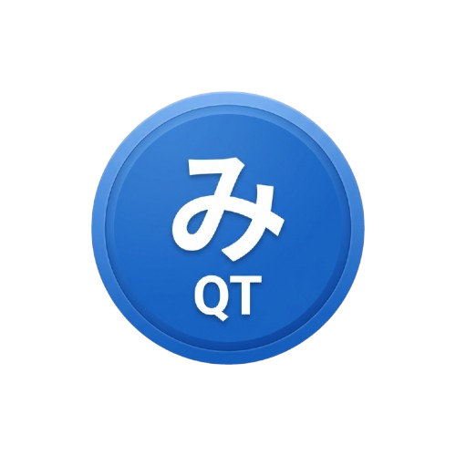

<p align="center">
  
  <h1 align="center">MihonQT</h1>
</p>
<p align="center">
  <a href="https://github.com/fam007e/mihonQT/releases/latest">
    
  </a>
  <a href="https://github.com/fam007e/mihonQT/actions/workflows/build.yml">
    
  </a>
  <a href="https://github.com/fam007e/mihonQT/actions/workflows/security.yml">
    
  </a>
  <a href="https://github.com/fam007e/mihonQT/actions/workflows/static.yml">
    
  </a>
  <a href="https://discord.gg/F34duNjTqn">
    
  </a>
</p>

MihonQT is a desktop manga reader built with C++ and Qt 6 — a native port of
the [Mihon](https://github.com/mihonapp/mihon) (formerly Tachiyomi) Android
experience for Linux, Windows and macOS.

## ✨ Features

- **📚 Library Management:** Categories, unread and download badges, filters
  and reading-progress tracking.
- **🌐 JavaScript Extensions:** Manga sources as plain JS files with
  HTML5-correct parsing (Gumbo) and a full CSS selector engine, executed off
  the UI thread.
- **📖 Dual-Page Reader:** Cover offset, wide-page (splash) detection,
  RTL/LTR/vertical (webtoon) modes, page slider and per-chapter navigation.
- **⌨️ Full Keyboard Navigation:** Rail-focused hub-and-spoke navigation with
  arrows, Enter and Esc throughout the app.
- **🎨 Material 3 Theming:** The Mihon Android palettes (Mihon Default, Nord,
  Catppuccin, Tokyo Night, Dracula) plus a Pure Black AMOLED mode.
- **📥 Download Manager:** Multi-threaded chapter downloads with a queue UI.
- **📊 Statistics:** Insights into your reading habits.
- **🕶️ Incognito Mode:** Pause history tracking with a single toggle.
- **🔒 Secure by Design:** Incorporates mitigations from the 2026 security
  audit (extension trust, HTTPS enforcement, memory-safety hardening).

## 🚀 Getting Started

### Prerequisites

- CMake 3.16+ and a C++17 compiler
- Qt 6 (Core, Gui, Widgets, Network, Sql, Concurrent, Quick, Qml,
  WebEngine, Core5Compat)
- gumbo (HTML5 parser) and libwebp (pkg-config)
- QuaZip 1.5 — vendored in `libs/quazip`, nothing to install

### Build

```bash
cmake -B build -S . -DCMAKE_BUILD_TYPE=Release
cmake --build build -j
./build/MihonQT
```

Per-platform dependency lists and packaging notes live in the
**[Building wiki page](https://github.com/fam007e/mihonQT/wiki/Building)**
(also at [docs/wiki/Building.md](docs/wiki/Building.md)).

### Releases

Prebuilt binaries for Linux, Windows and macOS are published on the
[Releases](https://github.com/fam007e/mihonQT/releases) page.

## 📖 Documentation

| Page | Contents |
|---|---|
| [Building](docs/wiki/Building.md) | Per-platform dependencies and CMake invocations |
| [Keyboard Shortcuts](docs/wiki/Keyboard-Shortcuts.md) | The full navigation map |
| [JavaScript Extensions](docs/wiki/Extensions.md) | Writing manga sources |
| [Themes](docs/wiki/Themes.md) | Shipped Material 3 palettes and AMOLED |
| [FAQ](https://fam007e.github.io/mihonQT/FAQ.html) | Common questions |
| [Security Audit](docs/SECURITY_AUDIT.md) | Security posture and mitigations |

## 🔒 Privacy

- **No tracking:** no analytics, no telemetry.
- **Local first:** database and settings stay on your machine.
- **Incognito mode:** pause history tracking at any time.

## 🤝 Community

- [Discord](https://discord.gg/F34duNjTqn) — build help and chat
- [Issues](https://github.com/fam007e/mihonQT/issues) — bug reports and
  feature requests (templates included)

## 🗺️ Roadmap

See [ROADMAP.md](ROADMAP.md) for progress and planned features.

## 🤝 Contributing

Contributions are welcome! See [CONTRIBUTING.md](CONTRIBUTING.md) to get
started.

## 📄 License

This project is licensed under the MIT License — see [LICENSE](LICENSE)
for details.
